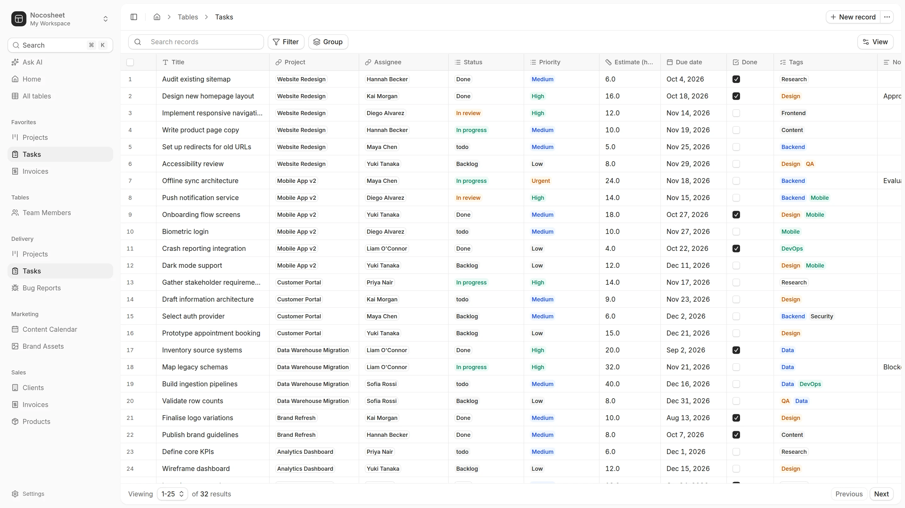

# Nocosheet

An open-source, offline-first no-code database. Build tables, work with records in a spreadsheet-style grid, and share them with your team. Self-host it on Cloudflare, one deployment per team.

<picture>
  <source media="(prefers-color-scheme: dark)" srcset="docs/screenshot-dark.webp" />
  
</picture>

## Features

- **Tables and columns**: create tables with a wizard, import columns from CSV, start from bundled templates.
- **Records grid**: search, filters, sorting, column summaries, inline editing and record sheets.
- **Relations and files**: link records with pickers, add file and image columns.
- **Saved views**: save column subsets and filters as views.
- **Import and export**: CSV import and export.
- **Trash**: deleted tables, columns and records are restored from the trash within 30 days.
- **Access control**: administrators and members, with access profiles that grant per-table permissions.
- **Workspace**: home page with stats and recent tables, sidebar with search and favorites, members and audit log.
- **Offline-first**: data is stored in the browser, so tables open instantly and records can be created, edited and deleted offline. Changes sync when the connection returns.
- **Installable**: works as a PWA and opens without a connection.
- **Authentication**: password, passkey, two-factor, Google sign-in, and account management.

## Run locally

```sh
pnpm install
pnpm dev
```

Copy `example.env` to configure settings. The first run asks you to create the first administrator at `/auth/setup`.

## Deploy

```sh
pnpm exec void deploy
```
